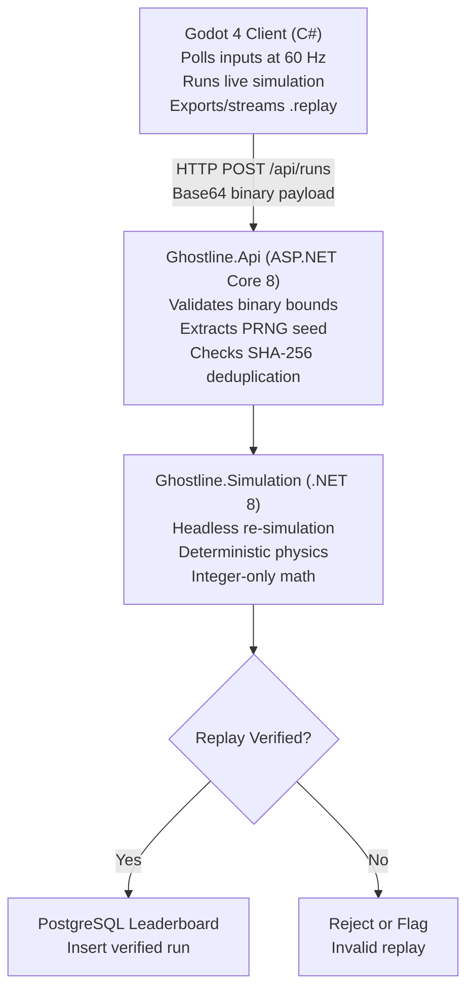

# Ghostline

[](https://github.com/marclourens19/ghostline/actions/workflows/dotnet.yml)
[](https://marclourens19.github.io/ghostline/)


> **Live Replay Inspector:** [https://marclourens19.github.io/ghostline/](https://marclourens19.github.io/ghostline/) — Drag and drop any `.replay` file to inspect tick telemetry, spatial inputs, and hit calculations directly in the browser.

Ghostline is a top-down 2D arena shooter built to demonstrate **authoritative server-side replay verification** for cheat-proof leaderboards.

Instead of trusting client-reported high scores or raw coordinates, the Godot game client records user input vectors tick-by-tick and packs them into a compact binary format (`GHST`, 15 bytes per frame). Upon match completion, the ASP.NET Core backend deserializes this stream and runs a headless, deterministic simulation of the entire match using integer-only fixed-point math. A score is only committed to the PostgreSQL leaderboard if the server's computed simulation state matches the client's claim.

---

## Architecture Overview



### Core Components

- **`src/Ghostline.Simulation/`**: Pure C# .NET 8 headless engine with zero external game-engine dependencies. Uses integer fixed-point vector math (1,000 millipixels = 1 visual pixel) to support deterministic simulation across Windows desktop and Linux server runtimes.
- **`src/Ghostline.Api/`**: Containerized ASP.NET Core Minimal API handling replay ingestion, bounds checking, SHA-256 deduplication, headless verification, and PostgreSQL leaderboard persistence.
- **`client/`**: Godot 4 .NET game client responsible for rendering simulation state, managing the HUD overlay, recording player inputs, and providing tick-accurate ghost spectating.
- **[`docs/replay-format.md`](docs/replay-format.md)**: Complete byte-level technical specification of the `GHST` binary replay format.

---

## How to Run

### 1. Launch Backend Infrastructure

Ensure Docker Desktop is running, then initialize the API and PostgreSQL containers:

```bash
docker compose up --build -d
```

The API starts on port `5000`, with Swagger documentation available at:

[http://localhost:5000/swagger](http://localhost:5000/swagger)

### 2. Launch the Client

1. Open the project inside **Godot 4.x (.NET version)**.
2. Build the C# solution inside Godot or via the .NET CLI:

   ```bash
   dotnet build
   ```

3. Press **F5** to start the client.

---

## Controls

| Input | Action |
|---|---|
| **WASD / Arrow Keys** | Move |
| **Left Mouse Click** | Fire bullet |
| **Space** | Dash |
| **Q** | Shockwave AoE |
| **E** | Shield bubble |
| **R** | Continuous laser beam |
| **Tab / L** | Toggle in-game leaderboard overlay |
| **F6** | Export local replay (`latest_run.replay`) |
| **F7** | Submit run to authoritative server |
| **F8** | Toggle replay spectator mode (watch ghost playback) |

---

## Storage & Scaling Considerations

### Current Implementation

In the current implementation, verified `GHST` replay binaries are stored directly in the `Runs` table in PostgreSQL using `bytea` columns. This approach keeps local development and deployment simple by storing replay data and related metadata in the same database.

### Architectural Trade-offs

Storing raw replay binaries directly in PostgreSQL offers several advantages:

- **Transactional consistency:** Replay data and its associated run metadata can be committed atomically.
- **Simpler infrastructure:** No separate object-storage service is required.
- **Straightforward retrieval:** Replay data can be queried using the same database connection as leaderboard records.

However, this design introduces trade-offs as the system scales:

- **Database growth:** Large replay payloads increase database storage requirements.
- **Backup overhead:** Binary data increases backup size and restoration time.
- **I/O contention:** Heavy replay ingestion and retrieval can compete with leaderboard queries.
- **Resource utilization:** Frequent reads and writes of large payloads can increase database I/O and memory pressure.

### Production Scaling Strategy

For a production deployment operating at scale, raw replay files could be offloaded to an S3-compatible object store, such as AWS S3, Cloudflare R2, or MinIO.

PostgreSQL would retain only the information needed for leaderboard queries and replay management.

| Data | Storage Location | Purpose |
|---|---|---|
| Replay binary (`.replay`) | Object storage | Stores the complete input-frame stream |
| Run ID | PostgreSQL | Uniquely identifies each submitted run |
| PRNG seed | PostgreSQL | Records the initial deterministic simulation seed |
| Player and score metadata | PostgreSQL | Supports leaderboard queries |
| Replay object key or URI | PostgreSQL | Locates the corresponding replay file |
| Verification verdict | PostgreSQL | Records whether the replay passed server-side verification |
| SHA-256 replay hash | PostgreSQL | Supports duplicate detection and integrity checks |

This hybrid architecture separates large binary payloads from relational data while preserving efficient leaderboard queries and centralized verification metadata.

For smaller deployments, PostgreSQL `bytea` remains a reasonable choice. Moving replay storage to object storage should be driven by actual payload sizes, database growth, traffic, and operational requirements rather than assumed to be necessary from the beginning.

---

## Replay Verification

Ghostline's replay verification pipeline is designed around deterministic simulation rather than trusting client-reported results.

1. The client records chronological player input frames.
2. Input frames are serialized into the `GHST` binary format.
3. The backend validates the replay header, frame count, payload size, and input ranges.
4. The server reconstructs the initial simulation state using the recorded PRNG seed and spawn coordinates.
5. The headless simulation replays the recorded inputs tick-by-tick.
6. The server compares the computed result against the submitted run data.
7. Only verified runs are accepted into the leaderboard.

The replay format uses integer millipixels to reduce floating-point divergence across supported runtime environments.

**Important:** Deterministic replay verification is only as reliable as the server-side simulation and validation rules. The server must independently calculate authoritative scores and outcomes; client-submitted scores must never be treated as authoritative.

---

## Technical Stack

| Technology | Role |
|---|---|
| C# / .NET 8 | Simulation engine and backend |
| Godot 4 (.NET) | Game client and rendering |
| ASP.NET Core Minimal API | Replay ingestion and verification endpoints |
| PostgreSQL | Leaderboard and run metadata persistence |
| Docker Compose | Local backend infrastructure |
| GitHub Actions | Continuous integration |

---

## Project Status

Ghostline is under active development. Features and implementation details may change as the simulation, replay verification pipeline, and leaderboard infrastructure evolve.

