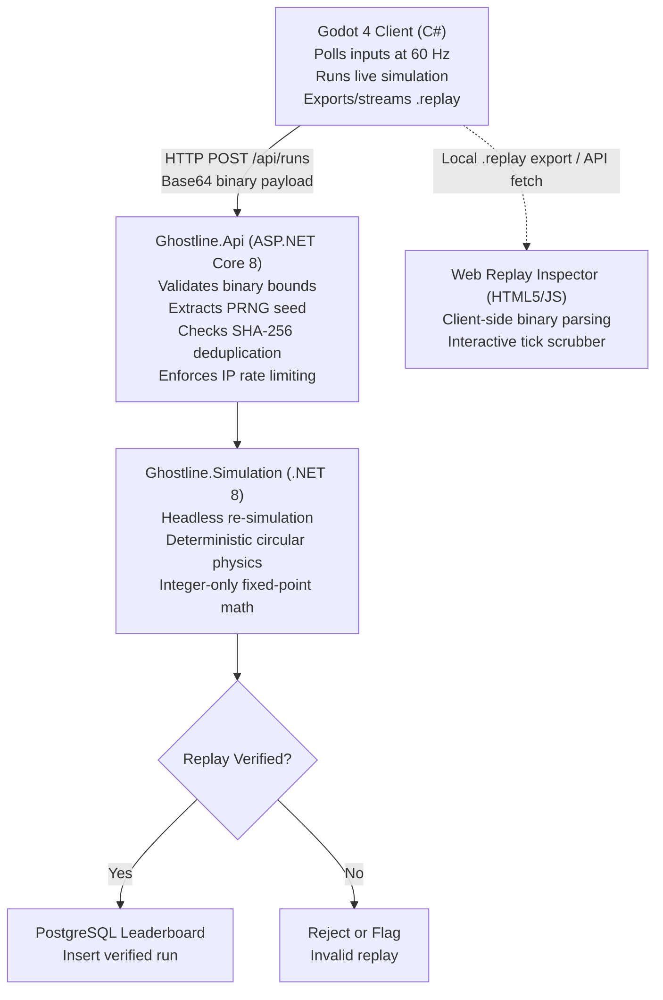

# Ghostline

[](https://github.com/marclourens19/ghostline/actions/workflows/dotnet.yml)
[](https://marclourens19.github.io/ghostline/)


> **Live Replay Inspector:** [https://marclourens19.github.io/ghostline/](https://marclourens19.github.io/ghostline/) — Drag and drop any `.replay` file to inspect tick telemetry, spatial inputs, and hit calculations directly in the browser.


Ghostline is a top-down 2D arena shooter built to demonstrate **authoritative server-side replay verification** for cheat-proof leaderboards.

Instead of trusting client-reported high scores or raw coordinates, the Godot game client records user input vectors tick-by-tick and packs them into a compact binary format (`GHST`, 15 bytes per frame). Upon match completion, the ASP.NET Core backend deserializes this stream and runs a headless, deterministic simulation of the entire match using integer-only fixed-point math. A score is only committed to the PostgreSQL leaderboard if the server's computed simulation state matches the client's claim.

---

## Architecture Overview



### Core Components

- **`src/Ghostline.Simulation/`**: Pure C# .NET 8 headless engine with zero external game-engine dependencies. Uses integer fixed-point vector math (1,000 millipixels = 1 visual pixel) to guarantee deterministic simulation across Windows desktop and Linux server runtimes.
- **`src/Ghostline.Api/`**: Containerized ASP.NET Core Minimal API handling replay ingestion, binary bounds checking, SHA-256 deduplication, IP-partitioned rate limiting, headless verification, and PostgreSQL leaderboard persistence with pagination and seed filtering.
- **`client/`**: Godot 4 .NET game client responsible for rendering simulation state, managing the HUD overlay, recording player inputs, and providing tick-accurate ghost spectating.
- **`web/`**: Zero-dependency HTML5 Canvas and JavaScript Replay Inspector deployed on GitHub Pages. Unpacks the 15-byte `GHST` frames directly in the browser with timeline scrubbing and live telemetry.
- **[`docs/replay-format.md`](docs/replay-format.md)**: Complete byte-level technical specification of the `GHST` binary replay format.

---

## How to Run

### 1. Launch Backend Infrastructure

Ensure Docker Desktop is running, create your local `.env` configuration, and initialize the API and PostgreSQL containers:

```bash
docker compose up --build -d
```

The API starts on port `5000`, with Swagger documentation available at:

[http://localhost:5000/swagger](http://localhost:5000/swagger)

### 2. Launch the Client

1. Open the project inside **Godot 4.x (.NET version)**.
2. Build the C# solution inside Godot or via the .NET CLI:

   ```bash
   dotnet build
   ```

3. Press **F5** to start the client.

### 3. Run the Automated Test Suite

Execute unit determinism tests, serialization fuzzing, and `WebApplicationFactory` in-memory integration tests:

```bash
dotnet test tests/Ghostline.Simulation.Tests/Ghostline.Simulation.Tests.csproj
```

---

## Controls

| Input | Action |
| --- | --- |
| **WASD / Arrow Keys** | Move |
| **Left Mouse Click** | Fire bullet |
| **Space** | Dash burst |
| **Q** | Shockwave AoE |
| **E** | Shield bubble |
| **R** | Continuous laser beam |
| **Tab / L** | Toggle in-game leaderboard overlay |
| **F6** | Export local replay (`latest_run.replay`) |
| **F7** | Submit run to authoritative server |
| **F8** | Toggle replay spectator mode (watch ghost playback) |

---

## API Endpoints

| Method | Endpoint | Description |
| --- | --- | --- |
| `GET` | `/api/health/db` | Health check verifying raw PostgreSQL connectivity and record counts. |
| `POST` | `/api/runs` | Submits a run payload (`PlayerName`, `ClaimedScore`, `Seed`, `ReplayBase64`). Protected by IP-partitioned rate limiting and SHA-256 deduplication. |
| `GET` | `/api/leaderboard` | Returns verified leaderboard entries. Supports `page`, `limit` (max 100), and optional `seed` query filters. |
| `GET` | `/api/runs/{id}/replay` | Downloads the raw `.replay` binary stream for playback in Godot or the Web Inspector. |

---

## Storage & Scaling Considerations

### Current Implementation

Verified `GHST` replay binaries are stored directly in the `Runs` table in PostgreSQL using `bytea` columns. This approach keeps local development and deployment simple by keeping replay data and related metadata transactional within the same database instance.

### Architectural Trade-offs

Storing raw replay binaries directly in PostgreSQL offers several advantages:

- **Transactional consistency:** Replay data and its associated run metadata are committed atomically.
- **Simpler infrastructure:** No separate object-storage service or access keys are required.
- **Straightforward retrieval:** Replay data is queried using the same database connection as leaderboard records.

However, this design introduces trade-offs as the system scales:

- **Database growth:** Multi-megabyte binary payloads increase database storage requirements.
- **Backup overhead:** Heavy binary data increases backup size, WAL throughput, and restoration time.
- **I/O contention:** Continuous replay ingestion and downloads compete directly with indexed leaderboard queries.

### Production Scaling Strategy

For high-throughput production deployments, raw replay binaries can be offloaded to an S3-compatible object store such as Cloudflare R2, AWS S3, or MinIO. PostgreSQL retains only relational metadata.

| Data | Storage Location | Purpose |
| --- | --- | --- |
| Replay binary (`.replay`) | Object Storage | Stores raw contiguous frame stream |
| Run ID (`UUID`) | PostgreSQL | Uniquely identifies each submitted run |
| PRNG seed (`uint32`) | PostgreSQL | Records initial deterministic simulation seed |
| Player and score metadata | PostgreSQL | Powers indexed leaderboard pagination and filtering |
| Object storage key / URI | PostgreSQL | References the target binary in object storage |
| Verification verdict | PostgreSQL | Records authoritative server validation status |
| Replay SHA-256 hash | PostgreSQL | Enforces unique replay submission deduplication |

---

## Replay Verification Pipeline

1. **Client Recording:** Captures quantized input vectors (movement axes, action bitmask flags, and reticle aim coordinates) at 60 Hz.
2. **Binary Serialization:** Encodes the match into a 21-byte header and contiguous 15-byte frames.
3. **Payload Sanitization:** The API validates Base64 integrity, bounds-checks frame counts (up to 432,000), enforces coordinate limits, and computes a SHA-256 hash to prevent duplicate replay submissions.
4. **Deterministic Resimulation:** The headless server simulation reconstructs the initial arena state using the embedded seed and runs the physics tick-by-tick.
5. **Verdict Commitment:** If the server's simulated score matches the client's claimed score, the run is flagged as `IsVerified = true` and ranked on the public leaderboard.

---

## Technical Stack

| Technology | Role |
| --- | --- |
| C# / .NET 8 | Headless deterministic simulation engine and Minimal API backend |
| Godot 4 (.NET) | Game client, hardware-accelerated rendering, and HUD |
| PostgreSQL | Relational leaderboard persistence and run records |
| Docker Compose | Multi-container orchestration (API + PostgreSQL) |
| HTML5 Canvas / Vanilla JS | Client-side Web Replay Inspector deployed on GitHub Pages |
| xUnit & WebApplicationFactory | Automated determinism testing and end-to-end API integration suites |
| GitHub Actions | Automated CI test runners and continuous static deployment |

---

## Project Status

Ghostline is actively maintained as an exploration of deterministic netcode, cheat-proof simulation architectures, and binary network protocols.
